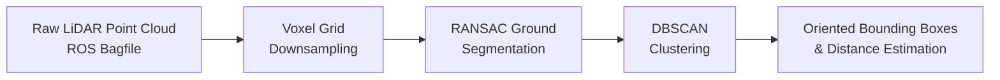
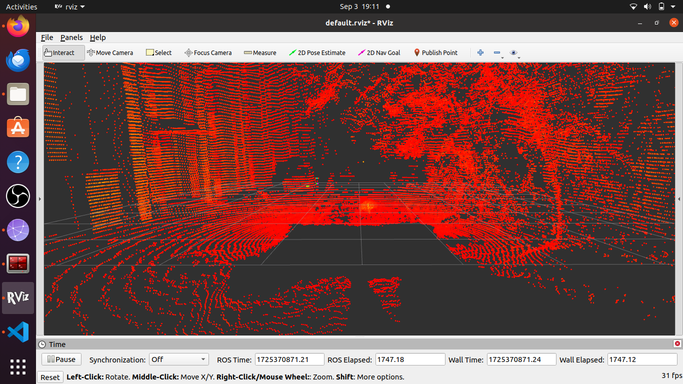
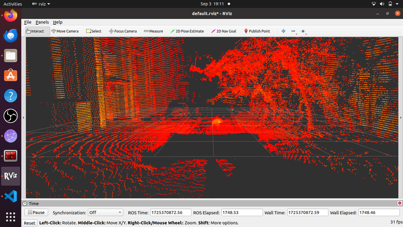
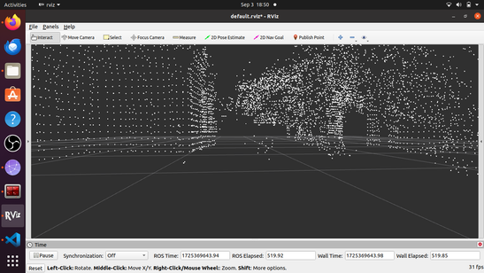
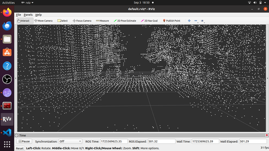
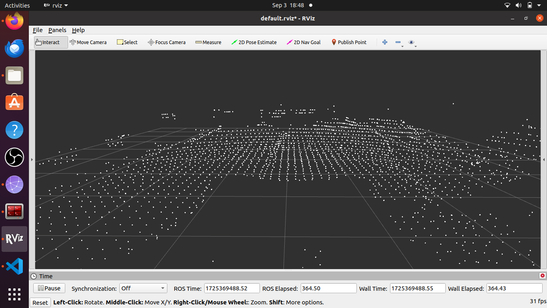
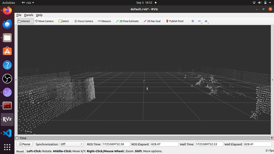
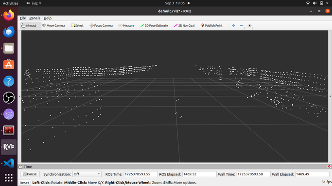
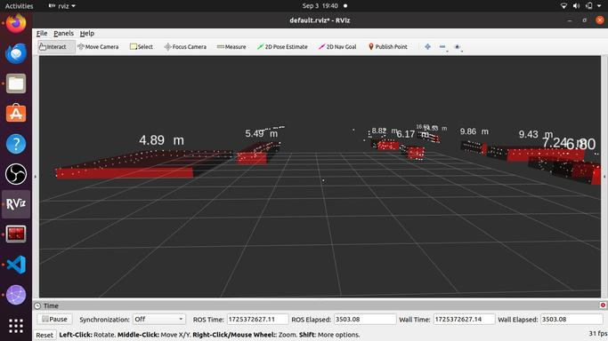

# 3D Point Cloud Object Detection (ROS)

A real-time 3D LiDAR perception and visualization pipeline built with ROS for autonomous vehicle obstacle detection. The pipeline ingests raw point clouds from a ROS bagfile, reduces computational overhead via voxel downsampling, isolates obstacles from the ground plane using RANSAC, clusters objects with DBSCAN, and renders oriented 3D bounding boxes with real-time distance estimates.

---

## Pipeline Architecture

---

## Tech Stack

* **Framework:** ROS (`<ROS 1 Noetic / Melodic / ROS 2>`)
* **Language:** `<C++ / Python>`
* **Libraries:** `<PCL / Open3D / NumPy / SciPy>`
* **Visualization:** RViz

---

## Implementation Details

### 1. Data Ingestion
Raw 3D LiDAR scans—represented as dense collections of $(x, y, z)$ coordinates—are streamed by playing back a recorded ROS bagfile. Because raw LiDAR data is dense, noisy, and redundant, it requires preprocessing before object extraction.

| Raw LiDAR Frame 1 | Raw LiDAR Frame 2 |
| :---: | :---: |
|  |  |

---

### 2. Voxel Grid Downsampling
To make subsequent computations faster and more efficient without significantly compromising geometric fidelity, the 3D space is partitioned into a uniform grid of voxels (small 3D cubes). Points within each voxel are averaged into a single representative centroid, preserving essential environmental features while reducing total point count.

| Downsampled View 1 | Downsampled View 2 |
| :---: | :---: |
|  |  |

---

### 3. Ground Plane Segmentation (RANSAC)
To isolate navigable road surfaces from potential obstacles, **RANSAC (Random Sample Consensus)** is applied to fit a plane model to the dominant ground surface, followed by ground filtering. Points are partitioned into two distinct sets:
* **Inliers:** Ground plane points (filtered out).
* **Outliers:** Elevated points representing potential obstacles.

| Segmented Ground Plane (Inliers) | Filtered Obstacles (Outliers) |
| :---: | :---: |
|  |  |

---

### 4. Spatial Clustering (DBSCAN)
Remaining non-ground outlier points are grouped into distinct objects using **DBSCAN (Density-Based Spatial Clustering of Applications with Noise)**. Unlike centroid-based methods, DBSCAN requires no prior assumption on the number of obstacles, detects objects of varying shapes and sizes, and naturally rejects sparse sensor noise.

| Clustered Obstacles (View 1) | Clustered Obstacles (View 2) |
| :---: | :---: |
|  |  |

---

### 5. Oriented Bounding Boxes & Distance Estimation
An oriented 3D bounding box is computed for each detected cluster based on its spatial extent. The Euclidean distance from the LiDAR sensor to each obstacle is calculated and overlaid in RViz, providing clear visual and spatial feedback for autonomous navigation.

*Detected obstacles rendered with oriented bounding boxes and real-time distance readouts (in meters).*

---

## Key Parameters

> *Update the values below to match the constants in your source code.*

| Stage | Parameter | Value |
| :--- | :--- | :--- |
| **Voxel Downsampling** | Leaf Size (`x, y, z`) | `<e.g., 0.1 m>` |
| **RANSAC Segmentation** | Distance Threshold | `<e.g., 0.2 m>` |
| **RANSAC Segmentation** | Max Iterations | `<e.g., 100>` |
| **DBSCAN Clustering** | `eps` (Search Radius) | `<e.g., 0.5 m>` |
| **DBSCAN Clustering** | `min_samples` | `<e.g., 10>` |

---

## Future Improvements

* **Parallelization:** Offloading voxelization and clustering to multi-threaded CPU execution or GPU kernels (CUDA) for higher-density LiDAR sensors.
* **Adaptive Parameters:** Dynamically adjusting DBSCAN `eps` based on radial distance from the sensor to account for LiDAR sparsity at long ranges.
* **Temporal Tracking:** Integrating a Kalman Filter or SORT-based tracker across consecutive frames to estimate obstacle velocity and maintain persistent IDs.